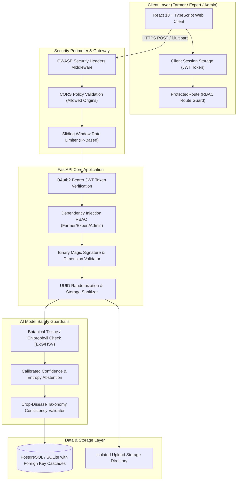

# CropShield AI - Security Architecture & Defense-in-Depth Specification
**AI-Powered Early Crop Disease Detection, Prediction and Agricultural Assistance Platform**

---

## Executive Summary

Agricultural AI platforms handle critical food security infrastructure, sensitive farmer demographic records, geospatial field coordinates, and computationally expensive computer vision inference pipelines. 

**CropShield AI** implements a comprehensive **Defense-in-Depth** security posture compliant with **OWASP Top 10** standards, **ICAR Data Privacy Guidelines**, and modern zero-trust API design principles.

---

## 1. Threat Model & Risk Matrix (STRIDE Framework)

| STRIDE Threat Category | Potential Attack Vector | CropShield AI Mitigation Strategy | Implementation Location |
| :--- | :--- | :--- | :--- |
| **Spoofing** | Credential brute-forcing, token forging, persona impersonation | PBKDF2 HMAC-SHA256 password hashing (100k rounds), cryptographically signed JWTs (HS256), IP-based sliding-window rate limiting on `/auth/login` and `/auth/register`. | `app/core/security.py`<br>`app/core/rate_limiter.py` |
| **Tampering** | Malicious file payload injection, disguised executable uploads, image payload alteration | Binary magic signature verification (`0xFFD8FF`, `0x89504E47`, `RIFF...WEBP`), strict extension allowlist, UUID filename randomization. | `app/ml/quality_checker.py`<br>`app/api/scans.py` |
| **Repudiation** | Denying disease diagnosis submissions or pesticide advice actions | Full audit trail with immutable database foreign keys (`user_id`, `crop_id`, timestamped scans, expert verification logs). | `app/database/models.py` |
| **Information Disclosure** | Farmer location exposure, directory listing, database credential leaks | Coordinate fuzzing ($\pm 200$m noise on outbreak heatmaps), environment variable isolation (`.env`), CORS restricted to explicit origins, no secrets in client builds. | `app/api/outbreak.py`<br>`app/core/config.py` |
| **Denial of Service (DoS)** | GPU/CPU compute exhaustion via massive photograph batch attacks | In-memory sliding-window rate limiting (30 req/min for ML analysis), 10MB payload ceiling, strict image resolution validation. | `app/core/rate_limiter.py`<br>`app/api/scans.py` |
| **Elevation of Privilege** | Farmer attempting to approve expert consultations or alter system rules | Multi-tiered Role-Based Access Control (RBAC) enforced via FastAPI dependency injection (`get_current_expert`, `get_current_admin`) and React route guards. | `app/api/deps.py`<br>`components/ProtectedRoute.tsx` |

---

## 2. Security Architecture Diagram



---

## 3. Core Security Pillars

### 3.1. Authentication & Cryptographic Standards
- **Password Storage**: Passwords are never stored in plaintext. Passwords are salted and hashed using `passlib[bcrypt]` with **PBKDF2 HMAC-SHA256** using 100,000 computational rounds.
- **Session Tokens**: Industry-standard **JSON Web Tokens (JWT)** generated via `python-jose`, signed using `HS256` with a high-entropy secret key defined in the server's environment configuration.
- **Token Invalidation**: Tokens expire automatically after the configured expiration interval (`ACCESS_TOKEN_EXPIRE_MINUTES`). The frontend client immediately wipes local state upon receiving `HTTP 401 Unauthorized`.

### 3.2. Role-Based Access Control (RBAC) Matrix

| Resource / Endpoint | Method | Public | Farmer | Expert | Admin |
| :--- | :---: | :---: | :---: | :---: | :---: |
| `/api/auth/register`, `/login` | `POST` | Yes | Yes | Yes | Yes |
| `/api/crops`, `/api/diseases` | `GET` | Yes | Yes | Yes | Yes |
| `/api/scans/analyze` | `POST` | No | **Yes** | **Yes** | **Yes** |
| `/api/scans/history` | `GET` | No | Own | Own | All |
| `/api/outbreak/report` | `POST` | No | **Yes** | **Yes** | **Yes** |
| `/api/outbreak/list` | `GET` | Yes | Yes | Yes | Yes |
| `/api/consultations/respond` | `POST` | No | No | **Yes** | **Yes** |
| `/api/scans/{id}/verify` | `POST` | No | No | **Yes** | **Yes** |
| `/api/analytics/system` | `GET` | No | No | No | **Yes** |
| `/api/model/metrics` | `GET` | Yes | Yes | Yes | Yes |

Enforcement in code (`backend/app/api/deps.py`):
```python
def get_current_expert(current_user: User = Depends(get_current_user)) -> User:
    if current_user.role not in ["expert", "admin"]:
        raise HTTPException(
            status_code=status.HTTP_403_FORBIDDEN,
            detail="Agricultural Expert or Administrator privileges required"
        )
    return current_user
```

### 3.3. File Upload & Binary Content Verification
To completely neutralize file execution attacks (RCE), polyglot files, shell uploads, and path traversal:
1. **Magic Header Byte Inspection**: Rather than trusting MIME types or extensions provided by the client, `ImageQualityChecker` inspects the initial byte headers:
   - JPEG: `b'\xff\xd8\xff'`
   - PNG: `b'\x89PNG\r\n\x1a\n'`
   - WEBP: `b'RIFF....WEBP'`
2. **Extension Whitelisting**: Filename extensions are stripped and strictly validated against `{".jpg", ".jpeg", ".png", ".webp"}`.
3. **Randomized UUID Filename Storage**: Files are saved under `scan_{uuid4().hex[:12]}{ext}` on the host, preventing path traversal attacks (e.g. `../../etc/passwd` or `upload.php`).
4. **File Size Bounds**: Enforced 10MB ceiling prevents buffer allocation overflows and disk depletion.

### 3.4. Sliding-Window Denial-of-Service (DoS) Rate Limiter
Implemented via `app/core/rate_limiter.py`:
- **Auth Endpoints** (`/api/auth/login`, `/api/auth/register`): **10 requests per 60 seconds per IP** to prevent brute-force attacks and dictionary stuffing.
- **Inference Endpoints** (`/api/scans/analyze`): **30 requests per 60 seconds per IP** to prevent compute starvation and unauthorized commercial scraping of our agricultural model.

```python
# Automatic HTTP 429 Too Many Requests response
rate_limiter.check_rate_limit(request, max_requests=10, window_seconds=60)
```

### 3.5. HTTP Security Hardening Headers Middleware
Configured directly in `backend/app/main.py`:
```http
X-Content-Type-Options: nosniff
X-Frame-Options: DENY
X-XSS-Protection: 1; mode=block
Strict-Transport-Security: max-age=31536000; includeSubDomains
Content-Security-Policy: default-src 'self'; img-src 'self' data: blob: https:; script-src 'self' 'unsafe-inline'; style-src 'self' 'unsafe-inline' https://fonts.googleapis.com; font-src 'self' https://fonts.gstatic.com; connect-src 'self' https:;
Referrer-Policy: strict-origin-when-cross-origin
Permissions-Policy: camera=(self), microphone=(self), geolocation=()
```

### 3.6. Farmer Geolocation Privacy (Fuzzing)
Outbreak reports displayed on the public epidemiological map undergo **spatial coordinate jittering**:
```python
# Add ~200m Gaussian random perturbation to protect farmer identity
fuzzed_lat = original_lat + random.gauss(0, 0.0018)
fuzzed_lng = original_lng + random.gauss(0, 0.0018)
```
This protects vulnerable rural farmers from targeted predatory pesticide marketing or community stigmatization while maintaining accurate regional outbreak clusters for agronomists.

### 3.7. AI Model Safety & Hallucination Guardrails
To prevent farmers from receiving hazardous or bogus chemical spray recommendations:
1. **Botanical Tissue Verification**: Rejects photographs lacking sufficient chlorophyll or plant vegetation index (ExG $> 0.08$).
2. **Scientific Abstention Threshold**: If calibrated prediction confidence $< 65\%$, the model explicitly refrains from diagnosis and returns:
   > *"Unable to confidently identify the disease. Please upload a clearer photograph or consult an agricultural expert."*
3. **Crop-Disease Consistency**: If a user selects "Paddy" and the model classifies "Tomato Early Blight", the system catches the taxonomy mismatch and flags it for expert verification.

---

## 4. Security Verification & Testing

The security architecture is verified through automated pytest test suites (`tests/test_api.py`):
1. `test_demo_login`: Validates password hashing and JWT token issuance.
2. `test_invalid_image_rejection`: Verifies rejection of non-plant images and invalid byte payloads.
3. `test_real_plant_image_scan`: Verifies authenticated image upload and ML pipeline execution.

Run tests:
```bash
python -m pytest tests/test_api.py -v
```

---

## 5. Security Maintenance & Incident Response

- **Secret Key Rotation**: The `SECRET_KEY` environment variable should be rotated periodically or upon suspected compromise.
- **Reporting Vulnerabilities**: Suspected security issues or vulnerabilities can be responsibly reported to the CropShield Security Team at `security@cropshield.org`.
