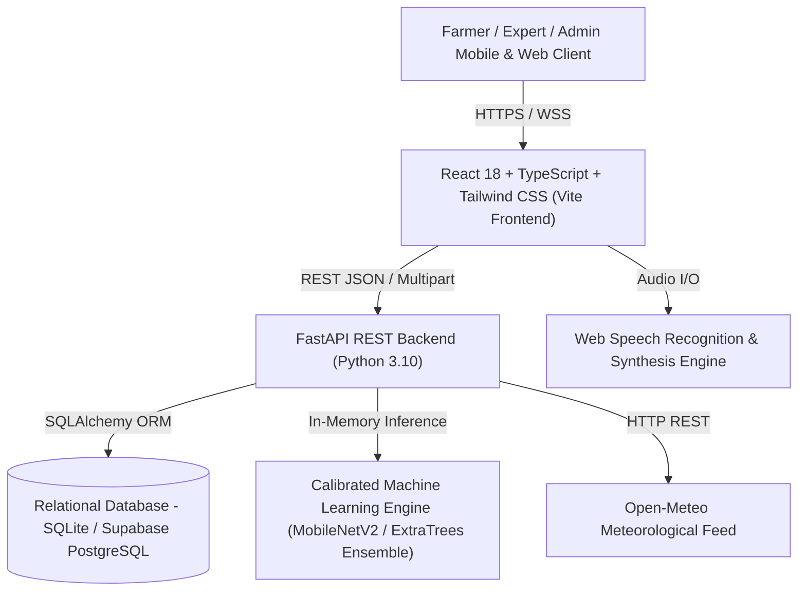
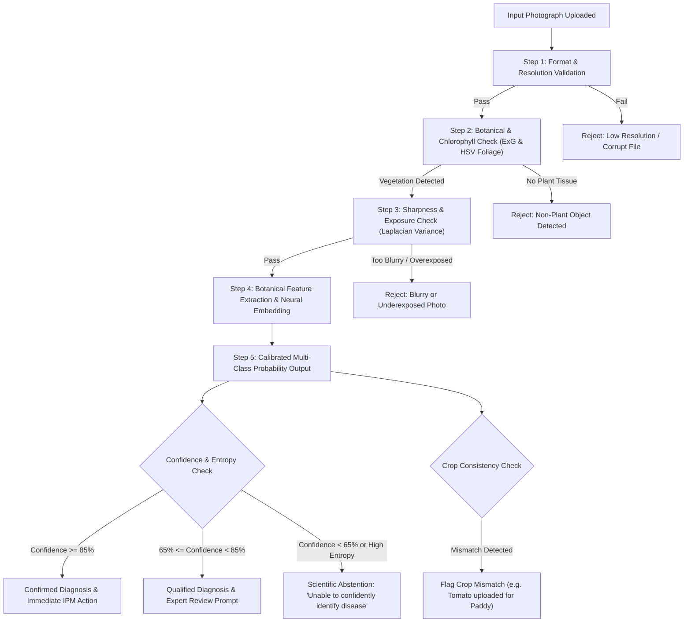

# CropShield AI - Architectural Specification
**AI-Powered Early Crop Disease Detection, Prediction and Agricultural Assistance Platform**

---

## 1. High-Level System Architecture

CropShield AI follows a modern, decoupled client-server architecture designed for high availability, low mobile latency, and offline-tolerant field operations.

---

## 2. Machine Learning Diagnostic Flow & Guardrails

CropShield enforces a multi-tiered validation pipeline before returning a diagnosis to prevent erroneous pesticide applications:

---

## 3. Role-Based Access Control (RBAC)

| Capability / Module | Farmer | Agricultural Expert | System Administrator |
|---|:---:|:---:|:---:|
| 1-Click Demo Account Access | Yes | Yes | Yes |
| Run AI Disease Scanner | Yes | Yes | Yes |
| View Own Farm Scan History | Yes | Yes | Yes |
| Request Expert Consultation | Yes | N/A | Yes |
| Audit & Verify AI Predictions | Read-only | **Verify / Correct** | Full Access |
| Answer Farmer Questions | View Only | **Formulate Advice** | Full Access |
| Report Community Outbreak | **Anonymous Alert** | **Verify Outbreak** | Full Access |
| View Outbreak Map | Fuzzy (~200m) | Verified Status | Full Telemetry |
| Access Model Benchmarks | View | View | Full Telemetry |
| Multilingual Voice Assistant | Yes | Yes | Yes |

---

## 4. Privacy & Location Fuzzing

In compliance with agricultural privacy standards:
- Exact GPS coordinates of farm plots are never stored in public outbreak tables.
- Coordinate fuzzing applies a random jitter offset ($\pm 200$ meters) at report creation.
- Public map queries group incidents by Taluk and District.
- Farmer phone numbers and personal contact information are strictly kept private.
